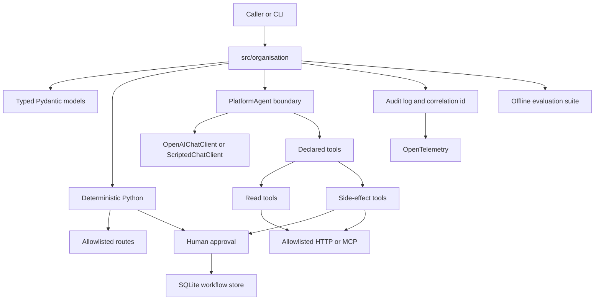

# Architecture

This repository is a private template for a client AI organisation. `src/agent_platform` is reusable platform IP. `src/organisation` is the implementation that a new engagement replaces. The reference organisation in that package is a fictional B2B customer-service team. It shows the pattern. A client deployment deletes it and puts the client's agents there.

Microsoft Agent Framework 1.x is the only agent framework. The default chat client is `OpenAIChatClient`. Microsoft Foundry stays an optional extra.

## Agent boundary

An organisation declares each agent with `AgentDefinition`: name, purpose, instructions, input model, output model, and the tools that agent may call. `create_agent` builds a `PlatformAgent`. `PlatformAgent.run` checks the input type, sends the model the JSON for that model, and parses the response into the output type. A response that does not match the schema raises `AgentOutputError`. The run does not accept extra tools at call time.

Offline tests pass a `ScriptedChatClient`. A live run passes `OpenAIChatClient`. The agent definitions stay the same.

## Deterministic decisions and model decisions

Use an agent when the step needs judgment, tool selection, or language. Use ordinary Python when the step is a rule.

In the reference organisation, Alex classifies a request. Python then routes that typed `specialist` field through `manager_workflow`. An unknown name raises `RouteRejected`. Jordan returns a verdict. Python applies it: return the answer, escalate, or open an approval. The model does not choose the next agent, the credential, or whether a write may run.

`sequential_workflow`, `concurrent_workflow`, and `conditional_workflow` are the other graph shapes. Routing predicates compare an allowlisted value.

## Tools and side effects

`prepare_tool` marks a function `ToolEffect.READ` or `ToolEffect.SIDE_EFFECT`. A read uses `approval_mode="never_require"`. A side effect uses `approval_mode="always_require"`. `execute_tool` is the gate that actually blocks a write until an `ApprovalDecision` matches that tool.

Give each agent only the tools its job needs. In the reference team, Sam has `read_account`, Taylor has `read_service`, and neither has `schedule_service`. The approval workflow holds the write.

## Human approval

`approval_workflow` pauses before the side-effect tool runs. The caller shows the action and collects a yes or no. `resume_approval` continues that pause. A repeated approval does not call the tool again. The store's guarantee is at-most-once for one idempotency key inside this process store. The key is the workflow name, correlation id, request id, and action. It is not exactly-once delivery to an external system.

## Workflow persistence

`memory_workflow_store` is for a single local process. `sqlite_workflow_store` is the durable store. The CLI uses SQLite when `APP_STATE_DIRECTORY` is set, and writes `workflows.sqlite` in that directory. The container sets the variable to `/data` and expects that path to be a mounted volume.

Checkpoints store hashes, identifiers, and approval metadata. They do not store argument values, prompts, model responses, or credentials. Resume rebuilds the workflow from the organisation code and requires the supplied arguments to hash to the stored value. A file whose schema version is not `1` or `2` is rejected. Checkpoint payloads from either of those versions stay readable, because the checkpoint body did not change.

`pending_requests.run_id` is the correlation id copied by the version 1 checkpoint format. It is not a foreign key to the run registry.

## Platform state version 2

Version 2 adds four records to the same SQLite file, behind the same store:

- **Ledger.** `append_ledger` stores an `AuditEvent`: correlation id, agent, tool, approval, outcome, kind, and argument hash. It does not store argument values. `AuditLog.add_sink` copies later in-memory events into the ledger. The in-memory log remains the process view used by evaluation.
- **Run.** `start_run` executes one name from the workflow catalog. The status machine is `running`, then `paused`, `completed`, or `failed`. Pausing requires a checkpoint that already belongs to that run. `bind_checkpoint` checks that the checkpoint's workflow name matches the run, and that a recorded graph signature matches. One checkpoint is bound to one run. `parent_run_id` records a parent. It does not start a nested graph.
- **Directory.** One organisation per scope, then roles, a repository allowlist, a workflow catalog, and teams. A team can name only roles and workflows that are already registered. Repository remotes are `https` URLs or `git@host:path` remotes without userinfo. Registering a repository does not call it.
- **Work item.** A draft holds a type, a title, a parent id, and a hash of the acceptance text. The acceptance text is not stored. Python moves `draft` to `ready` or `cancelled`, and `active` to `blocked`, `done`, or `cancelled` only while no mutating run holds the item. `start_run(..., mutating=True)` is the only way into `active`. A second non-terminal mutating run on that item fails closed. A read-only run may share the item. Independent work items run at the same time.

A new store is version 2. Opening a version 1 file does not create these tables. Calling a version 2 method raises `StateMigrationRequired`. `migrate_platform_state` creates the tables, sets the schema version to 2, and leaves checkpoint payloads and approval rows unchanged. The reference organisation does not register a directory and does not need the migration for its current approval flow.

## MCP and HTTP

`HttpClient` calls one configured base URL. Paths must stay on that host. The model does not supply the URL or the credential. A header provider closes over the secret. Reads may run immediately. Writes go through `execute_tool` and send no request until approval.

MCP servers come from `McpServerConfig`. The name, transport, command, URL, and credentials are configuration. A model cannot replace them or pass `url`, `command`, `headers`, or `authorization` as tool arguments. Each exposed remote tool has an explicit `ToolEffect`.

## Observability and correlation

`configure_observability` sets OpenTelemetry from `APP_` settings. Console export stays off unless `APP_ENABLE_CONSOLE_EXPORTERS` is true. Sensitive prompt and tool payloads stay off unless a caller sets `enable_sensitive_data=True`.

`bind_correlation_id` puts the turn's id in a context variable. HTTP and MCP read `current_correlation_id()`. They do not take it from model output. Audit events record the correlation id, agent, tool, approval state, outcome, and a hash of the arguments. They do not record argument values or secrets. Attaching a version 2 store with `AuditLog.add_sink` copies those same events into the durable ledger.

## Evaluation

`EvaluationCase` describes one scenario and the checks that matter: valid output, route, agents, tools, forbidden tools, approval actions, unapproved writes, secrets absent from the report, and optional scores. `run_evaluation` executes the suite and continues after a failure. The report does not copy case inputs or raw model output. The organisation supplies the cases and a `ScriptedChatClient` executor, so the suite runs without a live model.

## Security model

- Secrets stay in the environment or a local `.env`. The image does not contain `.env`.
- `SecretString.get_secret_value()` is called only where a client constructor needs a plain string.
- Credentials travel through client configuration or a header provider.
- Side effects require an allowlisted tool and a human decision.
- Unknown routes fail closed.
- Shared telemetry and checkpoints omit prompts, raw model responses, raw tool arguments, and credentials.
- The container process runs as uid 10001. Durable approval state lives on the mounted data directory.
