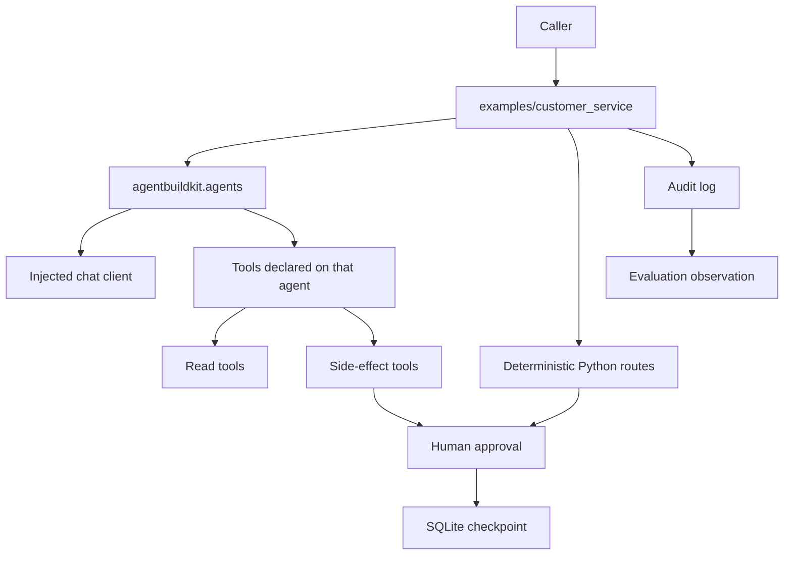

# AgentBuildKit

Build agents. Not demos.

AgentBuildKit is an open-source Python harness for building reliable AI agents. Workflows, tool boundaries, guardrails, evaluations, and human approval are enforced in code. A model may propose a decision. Python decides whether that decision is allowed to run.

The current release is an unreleased development version, `0.1.0.dev0`.

## What exists today

The core package is `agentbuildkit`. It provides typed agent inputs and outputs, deterministic route checks, per-agent tool allowlists, read versus side-effect classification, human approval, SQLite pause and resume, argument hashing, at-most-once side-effect execution, HTTP and MCP allowlists, an offline evaluation runner, correlation ids, audit events, and OpenTelemetry export.

`examples/customer_service` is a demonstration team. It is not part of the harness. Alex classifies a request, Python routes it to Sam or Taylor, and Jordan reviews the draft. Reference `A-100` and the account name Northwind are fixture data. The business API is an in-process mock at `http://business.test`. It does not call a CRM or a live customer-service backend.

Each agent declares its own provider and model on `AgentDefinition`. The provider registry builds the chat client for that pair. OpenAI and Anthropic are the built-in providers, and one workflow can mix them. `create_agent` still receives the client from the caller, and `build_team(clients=...)` still accepts one client per role, so tests inject `ScriptedChatClient` without constructing a live provider.

```python
from agentbuildkit.providers import ProviderConfiguration, builtin_registry

registry = builtin_registry()
alex = registry.create_client(ProviderConfiguration(provider="openai", model="gpt-4.1-mini"))
taylor = registry.create_client(
    ProviderConfiguration(provider="anthropic", model="claude-sonnet-4-5")
)
```

Constructing those clients needs the matching API key. The workflow that receives the clients does not branch on the provider.

## Current limitations

- Microsoft Agent Framework is the underlying runtime.
- The customer-service example runs on OpenAI unless a role is switched to Anthropic.
- The customer-service backend is fixture data behind a mock HTTP transport.
- Skills are not implemented.
- Persistent agent memory is not implemented.
- The dashboard is not implemented.
- Agent Bundles are not implemented.

## Architecture

```text
AgentBuildKit
├── src/agentbuildkit          Core harness
│   ├── agents                 Typed runs and injected chat clients
│   ├── providers              Per-agent provider registry; OpenAI and Anthropic adapters
│   ├── workflows              Routing, approval, SQLite pause/resume
│   ├── guardrails             Tool effect and human approval
│   ├── evaluation             Offline cases and audit-derived observations
│   ├── observability          Audit, correlation ids, OpenTelemetry
│   ├── integrations           Allowlisted HTTP, GitHub, and Cursor providers
│   ├── mcp                    Allowlisted MCP servers
│   ├── state                  Ledger, runs, directory, gates, and grants
│   ├── external_execution    Governed provider binding
│   └── config                 Settings, without logging secrets
└── examples/customer_service  Demonstration team and fixture data
```



## Run the example

Requires Python 3.12 and [uv](https://docs.astral.sh/uv/) 0.12 or newer.

```bash
uv python install 3.12
uv sync --locked
cp .env.example .env
PYTHONPATH=examples uv run python -m customer_service
```

Put `OPENAI_API_KEY` in `.env` for the default example. Leave that file uncommitted. Each example role declares `openai` and `gpt-4.1-mini` on its own agent definition. Switching a role to Anthropic also needs `ANTHROPIC_API_KEY`.

Offline tests do not call a model:

```bash
uv run ruff check .
uv run ruff format --check .
uv run pyright
uv run pytest
```

Microsoft Foundry stays an optional extra and is not installed by a normal sync:

```bash
uv sync --locked --extra foundry
```

## Docker

The image installs the locked core package, copies the example onto `PYTHONPATH`, runs as uid 10001, and does not contain `.env`. Approval state is SQLite on `/data`.

```bash
docker build -t agentbuildkit:local .
docker run --rm --entrypoint python agentbuildkit:local -m customer_service.health
```

The health check imports the harness and the example and confirms the data directory is writable. It does not call OpenAI.

## Layout

| Path | Purpose |
| --- | --- |
| `src/agentbuildkit` | Reusable harness |
| `examples/customer_service` | Customer-service demonstration |
| `docs/architecture.md` | How the reliability boundaries work |
| `docs/deployment.md` | Operator checklist |
| `tests/unit` | Offline tests |
| `tests/integration` | Live-service tests, marked and skipped unless opted in |

Historical consulting templates live in `docs/archive/consulting`. They are not the product.
