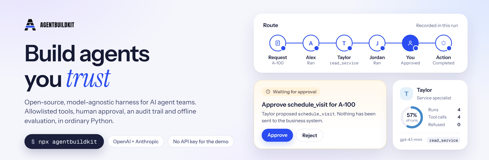
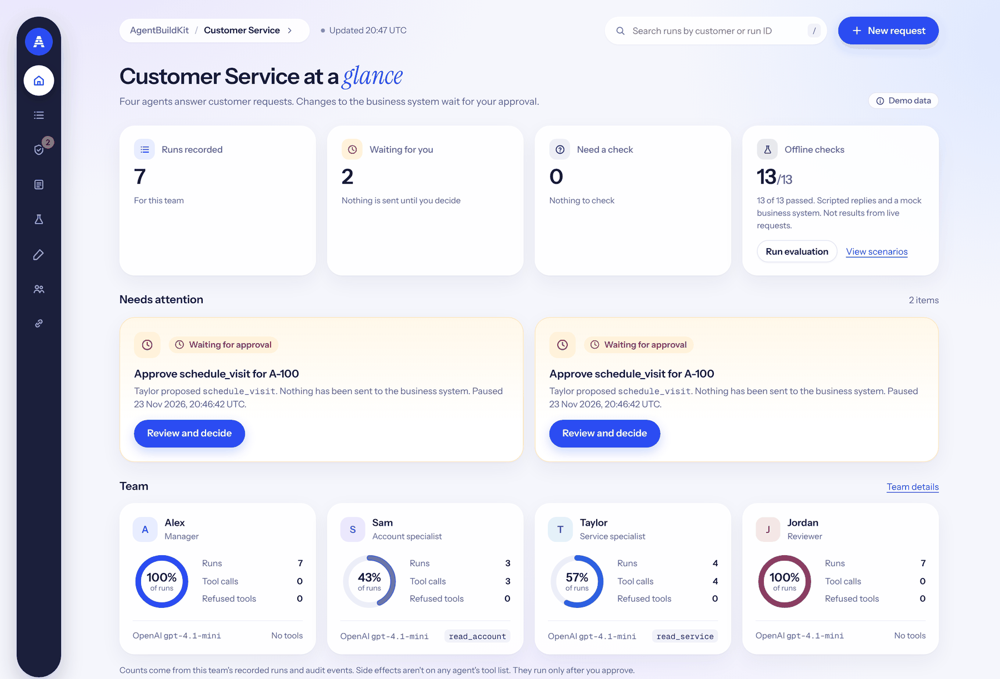
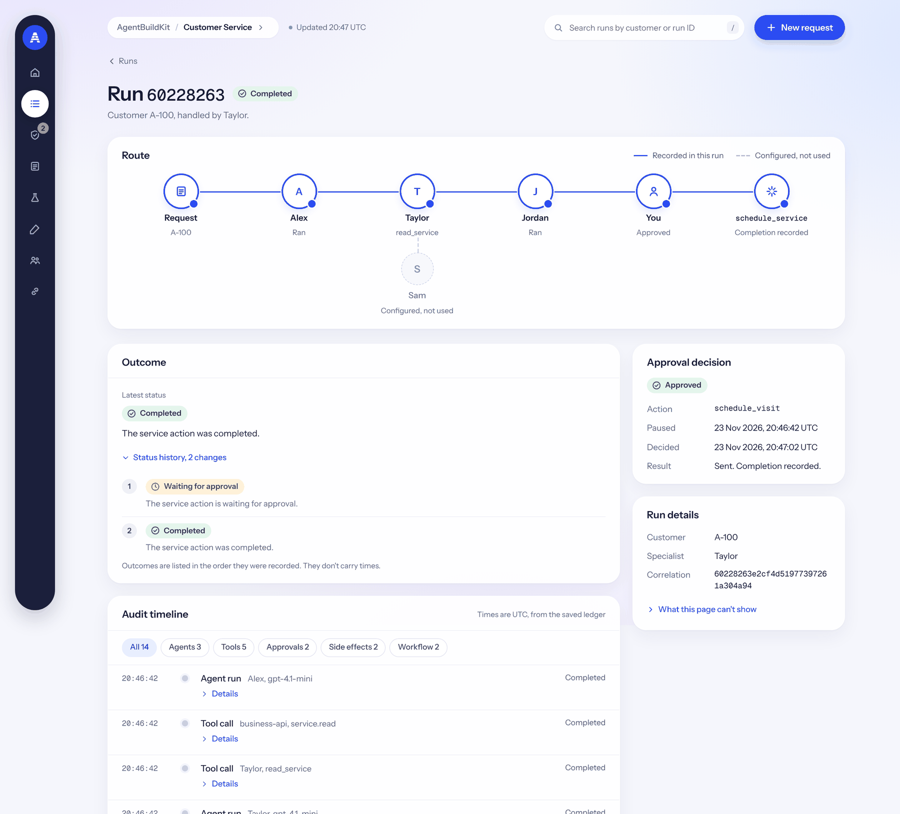

<p align="center">
  <a href="https://agentbuildkit.com">
    <picture>
      <source media="(prefers-color-scheme: dark)" srcset="https://raw.githubusercontent.com/agentbuildkit/agentbuildkit/master/docs/assets/readme/banner-dark.png">
      
    </picture>
  </a>
</p>

<p align="center">
  <a href="https://pypi.org/project/agentbuildkit/"></a>
  <a href="https://pypi.org/project/agentbuildkit-templates/"></a>
  <a href="https://www.npmjs.com/package/agentbuildkit"></a>
  <a href="https://github.com/agentbuildkit/agentbuildkit/actions/workflows/ci.yml"></a>
  
  
  <a href="LICENSE"></a>
</p>

<p align="center">
  <a href="#quick-start">Quick start</a> ·
  <a href="#local-dashboard">Dashboard</a> ·
  <a href="#supported-platforms">Platforms</a> ·
  <a href="docs/architecture.md">Architecture</a> ·
  <a href="#known-limitations">Known limitations</a> ·
  <a href="https://agentbuildkit.com">agentbuildkit.com</a>
</p>

# AgentBuildKit

**Build Agents You Trust**

AgentBuildKit is an open-source, model-agnostic agent framework harness for building, running and governing AI agent teams.

A model call returns text. A governed workflow decides who may act, which tools are allowed, when a person must approve a side effect, what is recorded, and how the same run can be repeated offline. AgentBuildKit is that harness. It uses Microsoft Agent Framework as its runtime. OpenAI and Anthropic are the built-in providers, and one team can use both.

## Quick start

```bash
npx agentbuildkit
```

That command installs the published harness, `agentbuildkit` 0.2.0, and the first-party templates, `agentbuildkit-templates` (any 0.2.x release, currently 0.2.1). It then runs `agentkit doctor`. In an interactive terminal it explains where state is stored, asks whether to open the local dashboard, and asks whether to run the offline demo.

You need Node.js 18 or newer, on macOS or Linux. The installer uses [uv](https://docs.astral.sh/uv/) to provide Python 3.12 in an isolated tool environment. It does not change the system Python and it does not ask for an API key. If `uv` is missing, an interactive terminal asks before running Astral's installer. A non-interactive run installs `uv` only when you pass `--install-uv`.

Useful flags:

```bash
npx agentbuildkit --no-demo --no-dashboard
npx agentbuildkit --state-directory /ABSOLUTE/PATH/agentbuildkit-state
```

Press Ctrl+C to stop the dashboard. A non-interactive run installs the tools, prints that it skipped the dashboard and the demo, and exits.

### Other ways to install

| Tool | Command |
|---|---|
| npm (recommended) | `npx agentbuildkit` |
| uv | `uv tool install --python 3.12 --managed-python --with "agentbuildkit-templates>=0.2.0,<0.3.0" "agentbuildkit>=0.2.0,<0.3.0"` |
| pip, in a Python 3.12 virtual environment | `pip install "agentbuildkit>=0.2.0,<0.3.0" "agentbuildkit-templates>=0.2.0,<0.3.0"` |
| From a clone | `uv sync`, then `uv run agentkit demo --approve` |

Older releases remain available. PyPI `agentbuildkit` 0.1.0 and npm `agentbuildkit` 0.0.2 install the harness only. Details, upgrades, and checkout installs are in [Install](docs/install.md).

## Why AgentBuildKit?

A prompt can ask a model to call a tool. It cannot, by itself, keep that call inside an allowlist, pause a write for a person, or show the same decision after a restart.

AgentBuildKit puts those boundaries in ordinary Python:

- **Tool execution boundaries.** Each agent receives only the tools named on its allowlist. A read may run. A side effect waits.
- **Human approval.** A side effect pauses until a person approves or rejects it. Approval runs that action at most once inside the local store.
- **Auditability.** The audit trail records the agent, provider, model, tool, and decision. It stores argument hashes, not argument values or secrets.
- **Repeatability.** The offline demo and the template evaluation suites run with scripted replies. The same expectations can be checked without a live model.
- **Provider flexibility.** Each agent declares its provider and model. OpenAI and Anthropic can appear in one workflow. The workflow does not branch on the provider.

## How it works

```text
Model → Agent → Tools → Workflow → Approval → State/Audit → Evaluation
```

The model supplies judgment and language. Python owns the rest. It checks the typed input and output, admits only allowlisted tools, chooses the next step from an allowlisted route, and refuses a side effect until an approval decision matches that action. The provider and model are fields on the agent. Callers can inject a scripted client, which is what the offline demo and the evaluation suites use.

```text
alex    → one provider and model
taylor  → another provider and model
jordan  → another provider and model
```

Those names are the offline demo. They are not a required team shape. See [Architecture](docs/architecture.md).

## What is included?

Version 0.2.0 includes:

- The `agentbuildkit` harness and the `agentkit` command.
- Typed agent inputs and outputs, per-agent provider and model, and deterministic workflow routing.
- Tool allowlists, human approval, SQLite pause and resume, and an audit ledger.
- Offline evaluation.
- Two installable templates in `agentbuildkit-templates`: Customer Service and Operations Reporting.
- A local dashboard for one operator, including drafts, runs, approvals, and the audit log.
- A local stdio MCP server for drafting an inactive team.
- Optional extras for Microsoft Foundry and for a read-only Google Sheets connection through Composio.

Skills, persistent agent memory, a template store, and hosted multi-user deployment are outside this release. The dashboard is a local operator interface. It is not a no-code builder and it does not certify a deployment.

## Run the offline demo

```bash
agentkit demo
agentkit demo --approve
agentkit demo --reject
```

`agentkit demo` needs no API key and does not call OpenAI or Anthropic. It runs a loading-bay request through the harness: the orchestrator selects the service route, the specialist reads an allowed tool, an unlisted tool is rejected, a side effect pauses, a person approves or rejects it, a reviewer checks the outcome, and the evaluation reads the audit trail. `--approve` and `--reject` supply that decision without a prompt.

From a clone, the same demo is `uv run agentkit demo --approve`.

## Local dashboard

<p align="center">
  
</p>

<details>
<summary><b>Run page:</b> the recorded route, the approval decision and the audit timeline</summary>
<br>
<p align="center">
  
</p>
</details>

<sub>Screens from `agentbuildkit-templates` 0.2.1 with scripted replies and the demo fixture (customer `A-100`). No live model was called.</sub>

After installation:

```bash
agentkit dashboard --state-directory /ABSOLUTE/PATH/agentbuildkit-state
```

The process binds to `127.0.0.1` and prints the URL, including the port chosen for that process. It has no login. Leave it in the foreground and press Ctrl+C to stop it. Opening the dashboard does not call a model.

State for that process lives in the directory you pass. The files include workflow checkpoints, `revisions.sqlite` for installed teams and drafts, recovery records, and optional connection records. `--state-directory` overrides `.env` and the shell. Without the flag, `APP_STATE_DIRECTORY` in a `.env` file in the current directory wins over the shell. With none of those, dashboard state lasts until the process stops.

Customer Service is served at `/teams/customer-service/` and Operations Reporting at `/teams/operations-reporting/`. Create team adds another inactive instance of one of those two templates. The instance can take a request after its draft is validated, evaluated offline, and activated. The scripted evaluation does not measure a live model.

Dashboard and MCP startup use POSIX `flock`. They stop with an actionable message when that lock is unavailable. Windows has not been verified for those commands.

## Agent teams and templates

`agentbuildkit-templates` 0.2.x installs two templates:

- **Customer Service.** Alex classifies a request. Python routes it to Sam or Taylor. Jordan reviews the result. A service change pauses for approval. The business data in the demo is a fixture: reference `A-100`, account Northwind.
- **Operations Reporting.** An analyst reads jobs and a reviewer checks that the summary names only those job ids. This team has no approval actions. The demo fixture uses job ids `J-100`, `J-200`, and `J-300`.

A new instance starts inactive, with no copied connections. Editing a draft does not activate it. These are the only registered templates. The package does not install a commercial bundle or a generated workflow. See [Team bundles](docs/team-bundles.md).

## Providers and integrations

Set a provider key only when a live agent uses that provider. `agentkit doctor` reports a missing OpenAI or Anthropic key and still succeeds.

- `OPENAI_API_KEY` for an OpenAI agent. The Customer Service defaults use OpenAI.
- `ANTHROPIC_API_KEY` for an Anthropic agent.
- Microsoft Foundry is the optional `foundry` extra. The default install leaves it out.
- Composio is the optional `composio` extra. It can connect one read-only Google Sheets window. The default install leaves it out. Disconnect removes the local assignment and does not revoke Google access.
- The harness can govern allowlisted GitHub operations and one Cursor execution grant. Credentials stay in configuration. See [Architecture](docs/architecture.md).

## Supported platforms

| | Supported | Notes |
|---|---|---|
| **macOS** | Yes | Installer, harness, demo, dashboard and MCP drafting |
| **Linux** | Yes | Installer, harness, demo, dashboard and MCP drafting |
| **Windows** | Not verified | Dashboard and MCP startup need POSIX `flock` |
| **Python** | 3.12 | The npm installer provides it through uv |
| **Node.js** | 18 or newer | Only for the `npx` installer |
| **Model providers** | OpenAI, Anthropic | Microsoft Foundry through the optional `foundry` extra |

## Security and governance

Side effects require an allowlisted tool and a human decision before they run. Approval inside the local store is at most once for that idempotency key. It is not exactly-once delivery to an external system. Unknown routes fail closed. Secrets stay in the environment or a local `.env`, which is not part of the package. Audit events and checkpoints omit prompts, raw arguments, and credentials.

These controls are the implemented behaviour of this release. They are not a certification, and they do not make every deployment secure. Private vulnerability reports go through [Security](.github/SECURITY.md).

## Known limitations

- Windows has not been verified for the dashboard or the MCP server.
- The dashboard serves one local operator on `127.0.0.1` with no login. It is not hosted multi-user deployment.
- Approval is at most once inside the local store, not exactly-once delivery to an external system.
- A passing scripted evaluation does not measure a live model or prove live readiness.
- Composio connects Google Sheets only, read-only, through one saved window.
- The MCP server drafts, validates and evaluates. It does not activate, run, approve or connect.

Open issues are tracked on [GitHub Issues](https://github.com/agentbuildkit/agentbuildkit/issues).

## Documentation

- [Install](docs/install.md)
- [Architecture](docs/architecture.md)
- [MCP drafting](docs/mcp.md)
- [Team bundles](docs/team-bundles.md)
- [0.2.0 release notes](docs/releases/0.2.0.md)
- [Changelog](CHANGELOG.md)
- [Deployment checklist](docs/deployment.md)
- [Contributing](CONTRIBUTING.md)

## Contributing

Clone the repository, install the development environment with `uv sync`, and run the checks in [Contributing](CONTRIBUTING.md). Python 3.12 is required. Pull requests need an offline test for new behaviour. Live provider tests use `@pytest.mark.integration`. Do not commit `.env` or credentials.

## Licence

Apache License 2.0. See [LICENSE](LICENSE).
