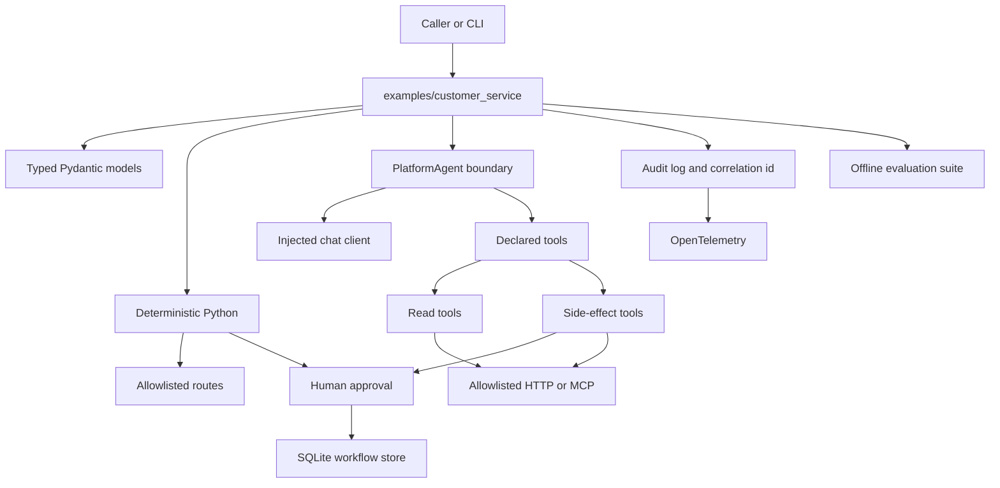

# Architecture

`src/agentbuildkit` is the AgentBuildKit harness. `examples/customer_service` is a demonstration team with fixture data, including reference `A-100`. Each agent declares a provider and a model. The provider registry builds the chat client. OpenAI and Anthropic are the built-in providers, and one team can mix them. Callers can still inject a chat client per agent. Offline tests use `ScriptedChatClient`.

Microsoft Agent Framework 1.x is the current runtime. Microsoft Foundry stays an optional extra.

## Agent boundary

A caller declares each agent with `AgentDefinition`: name, purpose, instructions, input model, output model, provider, model, and the tools that agent may call. The provider and model belong to that agent. They do not change the agent's name. `create_agent` receives a chat client and builds a `PlatformAgent`. `PlatformAgent.run` checks the input type, sends the JSON for the input model, and parses the response into the output type. A response that does not match the schema raises `AgentOutputError`. The run does not accept extra tools at call time. The run records the agent name, provider, and model on the audit event.

Offline tests pass a `ScriptedChatClient`. The example's live path asks the provider registry for one client per role. The agent definitions stay the same shape when the client changes.

## Deterministic decisions and model decisions

Use an agent when the step needs judgment, tool selection, or language. Use ordinary Python when the step is a rule.

In the customer-service example, Alex classifies a request. Python then routes that typed `specialist` field through `manager_workflow`. An unknown name raises `RouteRejected`. Jordan returns a verdict. Python applies it: return the answer, escalate, or open an approval. The model does not choose the next agent, the credential, or whether a write may run.

`sequential_workflow`, `concurrent_workflow`, and `conditional_workflow` are the other graph shapes. Routing predicates compare an allowlisted value.

## Tools and side effects

`prepare_tool` marks a function `ToolEffect.READ` or `ToolEffect.SIDE_EFFECT`. A read uses `approval_mode="never_require"`. A side effect uses `approval_mode="always_require"`. `execute_tool` is the gate that actually blocks a write until an `ApprovalDecision` matches that tool.

Give each agent only the tools its job needs. In the reference team, Sam has `read_account`, Taylor has `read_service`, and neither has `schedule_service`. The approval workflow holds the write.

## Human approval

`approval_workflow` pauses before the side-effect tool runs. The caller shows the action and collects a yes or no. `resume_approval` continues that pause. A repeated approval does not call the tool again. The store's guarantee is at-most-once for one idempotency key inside this process store. The key is the workflow name, correlation id, request id, and action. It is not exactly-once delivery to an external system.

## Workflow persistence

`memory_workflow_store` is for a single local process. `sqlite_workflow_store` is the durable store. The CLI uses SQLite when `APP_STATE_DIRECTORY` is set, and writes `workflows.sqlite` in that directory. The container sets the variable to `/data` and expects that path to be a mounted volume.

Team drafts are a separate file, `revisions.sqlite`, in that same directory. They version the two installed teams. They are not the work-item drafts below. Without the directory, team drafts last only until the process stops. An unsupported revision file is copied to a backup and left unchanged. Published revisions are immutable. Activation and rollback store hashes and revision ids, not instruction text. A run records its revision before it starts.

Checkpoints store hashes, identifiers, and approval metadata. They do not store argument values, prompts, model responses, or credentials. Resume rebuilds the workflow from the organisation code and requires the supplied arguments to hash to the stored value. A file whose schema version is not `1` or `2` is rejected. Checkpoint payloads from either of those versions stay readable, because the checkpoint body did not change.

`pending_requests.run_id` is the correlation id copied by the version 1 checkpoint format. It is not a foreign key to the run registry.

## Platform state version 2

Version 2 adds four records to the same SQLite file, behind the same store:

- **Ledger.** `append_ledger` stores an `AuditEvent`: correlation id, agent, tool, approval, outcome, kind, and argument hash. It does not store argument values. `AuditLog.add_sink` copies later in-memory events into the ledger. The in-memory log remains the process view used by evaluation.
- **Run.** `start_run` executes one name from the workflow catalog. The status machine is `running`, then `paused`, `completed`, or `failed`. Pausing requires a checkpoint that already belongs to that run. `bind_checkpoint` checks that the checkpoint's workflow name matches the run, and that a recorded graph signature matches. One checkpoint is bound to one run. `parent_run_id` records a parent. Starting a nested graph uses the delegation rules below.
- **Directory.** One organisation per scope, then roles, a repository allowlist, a workflow catalog, and teams. A team can name only roles and workflows that are already registered. Repository remotes are `https` URLs or `git@host:path` remotes without userinfo. Registering a repository does not call it.
- **Work item.** A draft holds a type, a title, a parent id, and a hash of the acceptance text. The acceptance text is not stored. Python moves `draft` to `ready` or `cancelled`, and `active` to `blocked`, `done`, or `cancelled` only while no mutating run holds the item. `start_run(..., mutating=True)` is the only way into `active`. A second non-terminal mutating run on that item fails closed. A read-only run may share the item. Independent work items run at the same time.

A new store is version 2. Opening a version 1 file does not create these tables. Calling a version 2 method raises `StateMigrationRequired`. `migrate_platform_state` creates the tables, sets the schema version to 2, and leaves checkpoint payloads and approval rows unchanged. The customer-service example does not register a directory and does not need the migration for its current approval flow.

Opening a version 2 file also adds the phase 3, 4, 5, and 6 tables when they are absent: workflow delegations, child outcomes, signals, child waits, tool permissions, gates, grants, grant uses, the GitHub binding tables, and external execution bindings. It adds `roles.permission_class` when that column is missing, signal subject columns when those are missing, and it narrows the one-mutating-run index to root runs. Checkpoint payloads are not rewritten. A missing core table such as `runs` still fails closed.

## Nested workflows

`allow_delegation(parent, child)` records that one catalogued workflow may start another. Unknown names and a missing edge fail closed. `start_child_run` is the call that enforces that edge. `start_run` can still record a parent id for an existing catalogued workflow; it does not grant a second mutating holder.

A child may be a mutating run on the work item its parent already holds, including a grandchild of that holder. The work item stays assigned to the original holder. Any other mutating run on that item fails closed.

Short-lived nesting goes through `run_nested_workflow`. That builds a parent graph whose only step is a Microsoft Agent Framework `WorkflowExecutor` around a separate child workflow. The wrapper has its own in-memory checkpoint storage. The check refuses a child that reuses a parent executor or a parent agent instance, so the two runs do not share model session memory. A child that finishes in process records a typed outcome: `completed`, `failed`, `rejected`, or `escalated`. Rejection and escalation are raised by Python in the child workflow. They are not selected from model text.

A wait that may outlive the process does not stay inside that in-memory executor. Bind a checkpoint to the parent, then `pause_for_child`. `finish_child_run` writes the typed outcome and a `child_finished` signal. After a restart, `take_child_outcome` reads that signal and moves a paused parent back to `running`. Taking the same outcome again does not start another run.

## Gates and grants

A gate is a named approval. It has a name, a role, a work item, a stage, the requested tool names, and a decision (`pending`, `approved`, or `rejected`). The role's permission class is one of `implementation`, `merge`, or `release`. Every requested tool must already be registered in that same class and listed on the role. A gate cannot mix implementation work with merge or release.

`decide_gate` records the human decision. Approval copies a grant from the gate. The grant names the work item, role, permission class, tool names, optional repository, optional branch prefix, the work-item status it was issued for, an optional expiry, and the argument hash of the one action. The decision call does not accept a new tool list. Grant records are frozen. There is no update operation.

`execute_tool(..., grant_id=..., grants=store)` loads that grant and checks it before a governed side effect. The tool name, argument hash, repository, and branch must fit the grant. A different hash, tool, repository, or branch does not run. An expired grant is marked expired. A grant whose work item has left the authorised status is marked invalidated. The same grant, tool, and argument hash runs at most once; a repeat returns `RepeatedGrantUse` and does not call the tool. Each use is appended to the durable ledger as `grant_used`, with the argument hash and not the argument values.

Callers that omit `grant_id` keep the version 1 `ApprovalDecision` path. The customer-service example's approval workflow uses that path. Merge and release remain separate roles and separate grants from implementation.

## GitHub

GitHub is the source of truth for issues, branches, commits, pull requests, checks, reviews, and releases. The platform stores the identifiers and content hashes a workflow needs to resume. It does not store issue text, pull request bodies, review text, or credentials.

A repository operation requires a directory entry whose remote is `https://github.com/owner/repo` or `git@github.com:owner/repo`. Any other remote, and any unknown repository, fails closed. The HTTP client uses `https://api.github.com` only. A model cannot supply a URL, a token, a remote, or a grant.

GitHub App credentials stay in `GITHUB_APP_ID`, `GITHUB_INSTALLATION_ID`, and `GITHUB_PRIVATE_KEY`. The authorizer signs an app JWT and exchanges it for an installation token. That token is a `SecretString` on the authorization header. It is not written to prompts, checkpoints, ledger rows, or logs.

Reads (`github.read_issue`, `github.read_pull_request`, `github.read_check`) run when the named role lists that tool. They do not require a write grant. Writes go through `execute_tool` and a grant:

- `github.create_branch`, `github.create_pull_request`, `github.create_comment`, and `github.create_review` are implementation tools.
- `github.merge_pull_request` is a merge tool.
- `github.create_release` is a release tool.

An implementation grant cannot merge or release. The default branch, `HEAD`, a `refs/` name, and any branch recorded with `protect_branch` are not implementation branches. An implementation or merge grant still has to match its branch prefix. A release grant has no branch. Creating a branch, pull request, or release a second time does not send another write. The same grant and argument hash returns `RepeatedGrantUse`.

Successful writes, a merged pull request read, and a completed check publish a signal (`github_branch_created`, `github_pull_request_opened`, `github_check_completed`, `github_review_submitted`, `github_pull_request_merged`, `github_release_published`). `pause_for_signal` holds a run that already has a checkpoint. `take_github_signal` consumes the signal and moves a paused run back to `running`. Taking it again does not start another run.

## External engineering execution

Cursor is an execution provider. It is not the organisation orchestrator. `delegate_implementation` is an implementation-class side effect. It runs only when an active grant names that tool, the work item, the repository, the branch prefix, and the current work-item state. The service derives the repository and the one authorised branch from the work item, its GitHub binding, and the grant. The model cannot supply a repository, a branch, a remote, or a credential.

The provider receives one `ImplementationAssignment`: work item, objective, acceptance source, repository URL, authorised branch, registered constraints, validation commands, fixed prohibitions, and the required completion line. The assignment does not include grants, approval metadata, credentials, or unrelated organisation state. The platform stores a hash of that assignment, not the text.

The binding stores the provider name, the external agent id, the provider run id, the organisation, work item, run, repository, branch, grant, attempt, status, and hashes. Cursor keeps the transcript. GitHub keeps the file contents. `implementation_started`, `implementation_completed`, and `implementation_failed` are the signals a paused run consumes. Taking the same signal twice does not start another run. An unknown external id fails closed.

The Cloud Agents API v1 differs from a free-form branch grant:

- The caller cannot name the branch Cursor creates. When automatic branching is left on, Cursor pushes a `cursor/...` branch. Delegation sets `workOnCurrentBranch` and `startingRef` to the branch Phase 5 already recorded, so commits stay on that branch. A completion whose pushed branch or repository does not match is a failure.
- `autoCreatePR` can open a pull request outside `github.create_pull_request`. Delegation always sends `false`. A reported pull request is a failure, not a governed pull request. Merge and release are not Cloud Agent operations and stay on the Phase 5 grants.
- v1 has no webhooks. The service returns after the agent id is stored. A later `observe_execution` reads `GET /v1/agents/{id}/runs/{runId}` and publishes the signal. The workflow does not hold a stream open. There is no first-party Python SDK in this repository; the client is the documented HTTP API.
- Create accepts a client-supplied `bc-<uuid>` agent id and returns `409` when that id already exists. A startup failure may retry that same id only after a read shows the agent was not created. Once an agent exists, a later failure does not start another one. A follow-up is a new run on the same agent and needs a new grant and attempt id.
- Cancel stops the current run. It does not delete the agent or grant merge rights. Agent status `ACTIVE` or `IDLE` is not the execution result; the run status is.

A startup failure, a lost response, a malformed payload, and a duplicate completion stay distinct. Lost contact does not start a second agent. A malformed payload is not treated as success.

## MCP and HTTP

`HttpClient` calls one configured base URL. Paths must stay on that host. The model does not supply the URL or the credential. A header provider closes over the secret. Reads may run immediately. Writes go through `execute_tool` and send no request until approval.

MCP servers come from `McpServerConfig`. The name, transport, command, URL, and credentials are configuration. A model cannot replace them or pass `url`, `command`, `headers`, or `authorization` as tool arguments. Each exposed remote tool has an explicit `ToolEffect`.

## Observability and correlation

`configure_observability` sets OpenTelemetry from `APP_` settings. Console export stays off unless `APP_ENABLE_CONSOLE_EXPORTERS` is true. Sensitive prompt and tool payloads stay off unless a caller sets `enable_sensitive_data=True`.

`bind_correlation_id` puts the turn's id in a context variable. HTTP and MCP read `current_correlation_id()`. They do not take it from model output. Audit events record the correlation id, agent, tool, approval state, outcome, and a hash of the arguments. They do not record argument values or secrets. Attaching a version 2 store with `AuditLog.add_sink` copies those same events into the durable ledger.

## Evaluation

`EvaluationCase` describes one scenario and the checks that matter: valid output, route, agents, tools, forbidden tools, approval actions, unapproved writes, secrets absent from the report, and optional scores. `run_evaluation` executes the suite and continues after a failure. The report does not copy case inputs or raw model output. The organisation supplies the cases and a `ScriptedChatClient` executor, so the suite runs without a live model.

## Security model

- Secrets stay in the environment or a local `.env`. The image does not contain `.env`.
- `SecretString.get_secret_value()` is called only where a client constructor needs a plain string.
- Credentials travel through client configuration or a header provider.
- Side effects require an allowlisted tool and a human decision. A governed side effect also requires a grant that names that tool.
- Unknown routes fail closed.
- Shared telemetry and checkpoints omit prompts, raw model responses, raw tool arguments, and credentials.
- The container process runs as uid 10001. Durable approval state lives on the mounted data directory.
